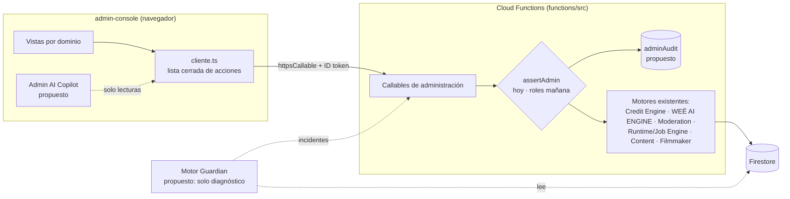

# Weë Admin Console — arquitectura maestra

> Documento vivo. Distingue SIEMPRE lo que existe hoy de lo propuesto. Estados: **VERIFIED EXISTING** · **IMPLEMENTED AND TESTED** · **PARTIALLY IMPLEMENTED** · **DESIGNED, NOT IMPLEMENTED** · **BLOCKED BY DEPENDENCY** · **NOT APPLICABLE**.
> Inventario hecho el 2026-10-30 sobre el worktree `wt-admin-console` (rama `claude/wee-admin-console-architecture-5zo37e`, base `5efbc0a`, primer commit local `528dbd9`). Documentos hermanos: [mapa de dominios](WEE_ADMIN_CONSOLE_DOMAIN_MAP.md) · [permisos](WEE_ADMIN_CONSOLE_PERMISSION_MATRIX.md) · [contratos](WEE_ADMIN_CONSOLE_API_CONTRACTS.md) · [seguridad](WEE_ADMIN_CONSOLE_SECURITY_MODEL.md) · [operaciones](WEE_ADMIN_CONSOLE_OPERATIONS.md) · [hoja de ruta](WEE_ADMIN_CONSOLE_ROADMAP.md).

## 1. Resumen ejecutivo

La Admin Console es el **centro de control privado** de Weë: mira, entiende y —cuando el servidor tenga las operaciones seguras— administra la plataforma. **No crea contenido** (eso es la app y Weë Studio) y **no reimplementa** ningún motor: supervisa los que existen a través de callables de administración protegidos por `assertAdmin`.

Hoy es una app web aparte (`admin-console/`, Vite + React 19) que **solo funciona contra emuladores `demo-*`** y solo hace **lecturas**. El servidor ya tiene **rol owner, matriz de permisos, `adminAudit`** y lecturas de **trabajos** y **cuentas** (`functions/src/admin`, sin desplegar). Lo que falta es lo que exige otra decisión: incidentes, Guardian y cualquier escritura (§8).

## 2. Inventario del estado actual

### 2.1 La consola

| Pieza | Estado |
|---|---|
| App aislada (tsconfig y Metro de la raíz la excluyen; no importa nada de la app salvo el traductor puro) | IMPLEMENTED AND TESTED (`admin-console-frontera`) |
| Solo emuladores `demo-*` en 127.0.0.1 (`config/entorno.ts`) | IMPLEMENTED AND TESTED |
| Sesión Firebase Auth; comprobación de permiso en el servidor ANTES de pintar el menú | IMPLEMENTED AND TESTED (navegador + emulador, 2026-10-29) |
| Lista cerrada de 8 lecturas (`api/acciones.ts`) | IMPLEMENTED AND TESTED |
| Vistas: Resumen (motor de IA), Credits (conversión US$ 1 = 100, totales, cuenta, reembolsadas, costes), Moderación (cola + historial) | IMPLEMENTED AND TESTED |
| Español por defecto e inglés, con el traductor de Weë | IMPLEMENTED AND TESTED |

### 2.2 El servidor que la consola puede usar

| Callable (solo administración) | Lecturas | Escrituras | Actor registrado |
|---|---|---|---|
| `engineAdmin` | `status` | `seedDefaults`, `setProvider`, `setRouting`, `setSettings` (incl. `iaDetenida`, `maxUsdPerDay`), `resetHealth` (memoria de la instancia) | solo `setSettings` → `updatedBy` |
| `creditsAdmin` | `stats`, `balance` (sin efectos), `userHistory`, `failed`, `costs` (sin `packages`) | `setCost` | no |
| `grantCredits`, `refundCredits`, `spendCredits` | — | mueven dinero | `source:'admin'`, sin actor |
| `moderationAdmin` | `list` (máx. 50), `history` | `review` (registra la decisión; **nada la ejecuta**) | sí, en `reports/{id}/history` |
| `evalRun` | — | ejecuta evaluaciones con dinero real de proveedor (cerrado por `aiSettings/evalBudget`) | `requestedBy`, `canceladoPor` |
| `mediaCanary` | `listar` (medios de la propia cuenta del admin) | `subir`, `confirmar`, `procesar`, `entregar` | sesión |
| **`opsAdmin`** (nuevo, sin desplegar; pide permiso, no solo admin) | `quienSoy`, `capacidades`, `trabajos`, `atascados`, `creaciones`, `producciones`, `generaciones`, `usoIa`, `reservas`, `auditoria` | ninguna | `adminAudit` |
| **`accountsAdmin`** (nuevo, sin desplegar) | `buscar` | ninguna | `adminAudit` |

### 2.3 Lo que NO existe (y por tanto no se pinta como si existiera)

- «Motor Guardian» como servicio: el Guardian actual (`ops/harness/guardian.mjs`) es herramienta de CI que informa y no bloquea.
- Incidentes: no hay colección; las alertas son políticas como código (`ops/observabilidad/alertas.mjs`) que la persona dueña aplica con gcloud.
- Suspender / restringir cuentas (el estado `SUSPENDED` es solo un tipo) y ejecutar decisiones de moderación.
- Salud persistida de proveedores: `engine.status().health` es memoria de UNA instancia. Informe del barrido: solo deja recuentos en los registros.
- Contadores de cuentas, activos o registros: ningún agregado servidor los calcula.
- `opsAdmin.capacidades` lo dice también en tiempo de ejecución.

### 2.4 Experiencias

| Experiencia | Rastro de servidor supervisable | Estado para la consola |
|---|---|---|
| Weë Studio | `creatorJobs`, `aiGenerations`, `creditTransactions`; vídeo por `generateVideo`; mundo 3D por `generateWorld` (cerrado por `aiSettings/runtime`) | IMPLEMENTED AND TESTED (lectura) |
| Filmmaker | `productions` (el sobre); despliegue en producción sin verificar | PARTIALLY IMPLEMENTED |
| Weë Chef, Weë Travel | `creatorJobs` con `experienceId` | IMPLEMENTED AND TESTED (lectura) |
| Weë Design | simulación en el cliente, sin servidor | NOT APPLICABLE hasta que tenga servidor |
| Weë Music | `music.generate` PENDIENTE; sin conexión | NOT APPLICABLE |

## 3. Arquitectura objetivo

Principios:

1. **Un solo camino**: navegador → callable de administración → motor existente. La consola nunca lee ni escribe Firestore/Storage directamente.
2. **El permiso es del servidor**, en cada llamada. La consola solo lo refleja.
3. **Ningún motor duplicado**: ni segundo Router, ni segundo motor de Credits, ni segundo sistema de alertas.
4. **Lecturas agregadas en el servidor**, paginadas y con techo (como `assertLimit`): nunca colecciones enteras al navegador.
5. **Cada dato con su fuente, ventana y frescura**, y lo que no se mide se dice «no disponible»: nada inventado ni simulado como si fuera real.
6. **Escrituras solo con**: rol suficiente, motivo, confirmación, auditoría que falle cerrada, y validación en el servidor.

### 3.1 Estructura del frontend

`admin-console/src/` — `api/` (acciones, cliente, errores, modelos normalizadores), `auth/`, `config/`, `componentes/` (piezas comunes: Cargable, Dato, Tabla, Etiqueta…), `i18n/` (es, en), `vistas/` (una por dominio). Cada dominio nuevo = acciones en la lista cerrada + normalizador + vista + pruebas; nada de componentes monolíticos.

### 3.2 Navegación

Se construye con lo que **funciona**, no con marcadores vacíos. Hoy: **Panorama · Motor de IA · Credits · Moderación**, y según el permiso que confirma el servidor **Operaciones · Cuentas · Auditoría**. Grupos previstos cuando haya datos reales: Operaciones (incidentes, trabajos, Guardian) · IA y creación · Personas y comunidad · Credits y finanzas · Seguridad y sistema · Copiloto. Detalle en el [mapa de dominios](WEE_ADMIN_CONSOLE_DOMAIN_MAP.md).

## 4. Modelo de auditoría (IMPLEMENTED AND TESTED para lecturas)

Colección `adminAudit/{id}`, escrita SOLO por el servidor (`functions/src/admin/auditoria.ts`), nunca editable ni borrable desde administración. Campos: `actorUid`, `actorRol`, `accion` (`callable.action`), `recurso` (tipo + id), `motivo`, `en`, `correlationId`, `entorno`, `resultado` (ok / denegado / error + código), `metadatos` (solo valores simples y no sensibles). Para las acciones sensibles futuras: `antes`/`despues`, `confirmado`, `incidenteId`/`jobId`. Para dinero, privilegios y destructivas: si el registro no se puede escribir en la misma transacción, la acción **no se hace**. Detalle en [seguridad](WEE_ADMIN_CONSOLE_SECURITY_MODEL.md).

## 5. Modelo de incidentes (propuesto)

`incidents/{id}`: `severidad`, `estado` (abierto → investigando → mitigado → resuelto), `servicios`, `primeraVez`, `ultimaVez`, `afectadas`, `evidencias` (correlationIds, jobIds), `causaProbable` + `esHipotesis`, `pasosRecomendados`, `verificacion`, `responsable`, `historial`. Lo alimentan las alertas existentes y el Guardian; no se crea un segundo motor de alertas. Detalle en [operaciones](WEE_ADMIN_CONSOLE_OPERATIONS.md).

## 6. Motor Guardian (propuesto)

Servicio de **diagnóstico** sobre señales que ya existen: dinero sin cerrar (`creditTransactions` AUTHORIZED viejas, como el script de reservas colgadas), trabajos en `running`/`waiting` vencidos (`jobs`), barrido incompleto, proveedores caídos (`aiGenerations` con error), tope diario (`aiUsage`). Produce incidentes con evidencias y recomendaciones marcadas como hipótesis. **Nunca** concede Credits, toca dinero, cambia privilegios, borra datos ni cambia configuración. La recuperación automática es una fase posterior con política, idempotencia, reintentos acotados, auditoría y marcha atrás.

## 7. Admin AI Copilot (propuesto)

Asistente de análisis que usa **las mismas callables y la misma matriz de permisos** con el token de quien pregunta. Tres permisos separados: leer, preparar una acción, ejecutarla (esto último solo con confirmación explícita y auditoría). Trata como **datos no fiables** los logs, denuncias, publicaciones y respuestas de proveedores (inyección de instrucciones). No ve secretos y no envía datos personales o financieros innecesarios a un proveedor externo. Empieza en solo lectura. Su llamada a un modelo pasa por el WEË AI ENGINE (nunca un adaptador propio).

## 8. Bloqueos y decisiones del dueño

| Bloqueo | Por qué | Qué desbloquea |
|---|---|---|
| Desplegar `opsAdmin`, `accountsAdmin`, la regla de `adminAudit` | Decisión del dueño: están en `no_se_despliegan` | Autorización de despliegue |
| Escrituras en la consola | Faltan políticas, confirmación y recuperación | Decisión del dueño |
| Incidentes y Guardian | No hay colección ni servicio | Diseño y autorización |
| Apuntar la consola a producción | Hoy se niega por diseño (`config/entorno.ts`) | Hosting propio + decisión del dueño |
| Los emuladores de siempre (9099/5001/8080) | Los ocupa otro proceso (`demo-wee-persa`, worktree `wt-i18n-fa`), que no se toca | Se usan puertos alternativos: ver [operaciones](WEE_ADMIN_CONSOLE_OPERATIONS.md) |

## 9. Criterios de aceptación globales

Ver la [hoja de ruta](WEE_ADMIN_CONSOLE_ROADMAP.md). Un dominio solo se marca IMPLEMENTED AND TESTED con: callable de servidor con `assertAdmin` (o rol) probado sin sesión / sin permiso / con permiso; normalizador tolerante a basura; vista con estados de carga, vacío, error y «no disponible»; textos en es y en; prueba de frontera actualizada; y, si escribe, auditoría que falla cerrada.
